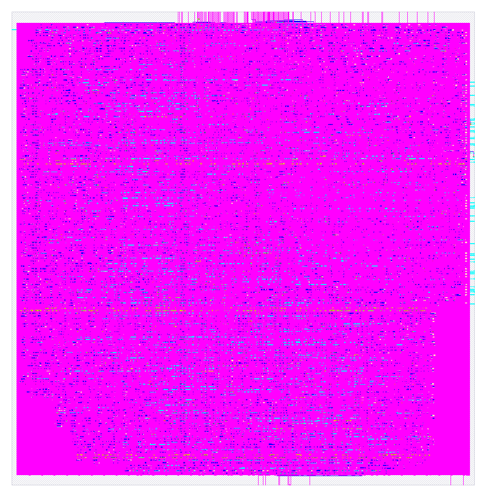

# RISC-V Core: RTL to GDSII in SkyWater 130nm

[](https://colab.research.google.com/github/Raushan-kumar0/riscv-rtl2gds-sky130/blob/main/run_in_colab.ipynb)

Takes the 5-stage pipelined RV32I core from
[riscv-pipeline-rv32i](https://github.com/Raushan-kumar0/riscv-pipeline-rv32i)
through the complete open-source ASIC flow ([LibreLane](https://github.com/librelane/librelane):
Yosys, OpenROAD, Magic, KLayout, Netgen) to a manufacturable GDSII layout in the
SkyWater 130nm process. Everything runs in Google Colab.

| | Run 1 (25 ns, 40 MHz) |
|---|---|
| Die size | 480 × 491 µm (0.24 mm²) |
| Standard cells | 13,293 (54.6% core utilisation) |
| DRC (router / Magic / KLayout) | **0 / 0 / 0** |
| LVS | **0** (layout matches the netlist) |
| Antenna violations | 0 |
| Setup timing, typical and fast corners | **met**: +10.1 ns worst slack at typical |
| Setup timing, slow corner (ss, 100 °C, 1.6 V) | **not met**: −4.4 ns (see analysis) |
| Hold timing, all corners | met |
| Power (estimated) | 6.1 mW |

---

## The chip



The full layout as rendered by KLayout. The magenta colour is the stacked metal
wiring and filler covering the core. The small marks along the top and right edges
are the input/output pins (instruction and data memory ports). The memories stay
outside this block, as on a real chip.

## What the flow does

| Step | Plain meaning |
|---|---|
| Synthesis | Turn the Verilog into a list of real SkyWater logic gates |
| Floorplan | Decide the chip size and where pins and power lines go |
| Placement | Put every gate at a spot on the chip |
| Clock tree (CTS) | Insert buffers so the clock reaches all 1,434 flip-flops at nearly the same time |
| Routing | Draw the metal wires (about 45 cm in total here) |
| Signoff | Timing (STA) at 9 corners, DRC (factory drawing rules), LVS (layout = netlist) |

A **corner** is one combination of manufacturing variation, temperature and voltage:
`tt` = typical chip at 25 °C and 1.8 V, `ss` = slow chip at 100 °C and 1.6 V (worst case),
`ff` = fast chip at −40 °C and 1.95 V. `nom/min/max` are wire-resistance variations.
**Slack** is spare time on the slowest path: positive means the timing is met.

---

## Results: two runs

Both runs used the same RTL and settings except the clock period.

| Metric | Run 1: 25 ns (40 MHz) | Run 2: 32 ns (31.25 MHz) |
|---|---|---|
| Standard cells | 13,293 | 13,301 |
| Cell area | 119,812 µm² | 119,850 µm² |
| Wire length | 452,764 µm | 452,820 µm |
| DRC / LVS / antenna | 0 / 0 / 0 | 0 / 0 / 0 |
| Worst setup slack, typical (max_tt) | **+10.12 ns** | **+13.20 ns** |
| Worst setup slack, slow (max_ss) | −4.42 ns | −4.89 ns |
| Setup violations (count, all in slow corners) | 608 | 223 |
| Total negative slack | −533.7 ns | −222.7 ns |
| Worst hold slack | +0.11 ns | +0.12 ns |
| Max-slew violations (all corners) | 1,360 | 1,398 |
| Power | 6.11 mW | 4.78 mW |

Setup slack per corner (ns):

| Corner | Run 1 (25 ns) | Run 2 (32 ns) |
|---|---|---|
| nom_tt_025C_1v80 | +10.56 | +13.79 |
| max_tt_025C_1v80 | +10.12 | +13.20 |
| min_tt_025C_1v80 | +11.02 | +14.34 |
| nom_ff_n40C_1v95 | +13.85 | +18.67 |
| nom_ss_100C_1v60 | −3.69 | −3.82 |
| max_ss_100C_1v60 | −4.42 | −4.89 |
| min_ss_100C_1v60 | −2.95 | −2.79 |

Full metrics for each run: [`results/run1_25ns/metrics.json`](results/run1_25ns/metrics.json),
[`results/run2_32ns/metrics.json`](results/run2_32ns/metrics.json).

### What the two runs show

1. **The layout is clean in both runs.** Zero DRC, LVS and antenna errors, and hold
   timing is met everywhere.
2. **Typical and fast corners pass with a large margin.** LibreLane's default sign-off
   for sky130 only treats typical-corner timing violations as errors, so both runs
   complete as passing by the tool's own criteria.
3. **The slow corner fails in both runs.** Slowing the clock from 25 to 32 ns cut the
   number of failing paths from 608 to 223 and the total negative slack by more than
   half. But the single worst path got slightly *worse* (−4.42 → −4.89 ns).
4. **Why the slower clock didn't fix it.** By default the placement and timing-repair
   steps optimise for the typical corner only, so nothing pushes the slow-corner paths
   to get faster. The slow corner also shows over 1,300 max-slew violations (signals
   switching too sluggishly), which make its delays large and sensitive to small
   placement differences. The netlist was almost identical between the runs (5,872
   logic cells in both; 2,369 vs 2,371 repair buffers), so the change in the worst path
   came from physical differences, not from the logic. This is my reading of the
   metrics; a detailed path report would be needed to confirm it.
5. **Next experiment (not yet run):** make the optimiser target the slow corner too,
   by adding `"PNR_CORNERS": ["nom_tt_025C_1v80", "max_ss_100C_1v60"]` to `config.json`.

**About "maximum frequency":** estimating fmax from typical-corner slack gives about
67 MHz for run 1 but about 53 MHz for run 2. The two numbers differ because each is only
valid for that particular implementation. The defensible statement is: **meets 40 MHz
at the typical corner with 10.1 ns of slack.**

### Where the 13,293 cells come from (run 1)
| Cell type | Count |
|---|---|
| Logic gates | 5,872 |
| Flip-flops (1,024 of them are the register file) | 1,434 |
| Buffers added to fix timing, slew and fanout | 2,369 |
| Clock-tree buffers and inverters | 277 |
| Tap cells (keep the silicon substrate connected) | 3,132 |
| Other (inverters, buffers, antenna diodes) | 209 |

Plus 29,535 filler cells that only fill empty space. A quick pre-layout synthesis
estimate gave about 7,900 cells and 71,500 µm²; the difference is the tap cells,
repair buffers and clock tree that only physical design adds.

---

## Run it yourself

1. Click **Open in Colab** at the top, then *Runtime → Run all*, and choose *Run anyway* if asked.
2. Keep the tab open and the computer awake. Setup takes about 15 minutes, and the flow about an hour.
3. Step 4 prints the results table, step 5 shows the layout, and step 6 downloads the results.

To change the clock target, edit `CLOCK_PERIOD` (in ns) in the notebook's `config.json` cell.

The notebook pulls the RTL from [riscv-pipeline-rv32i](https://github.com/Raushan-kumar0/riscv-pipeline-rv32i).
Its two setup cells are taken from LibreLane's official Colab notebook (Apache-2.0).

## Repository layout
```
run_in_colab.ipynb        one-click flow: setup, RTL, config, run, results, layout
config.json               LibreLane settings (run 1: 25 ns)
constraints.sdc           timing constraints: clock, I/O delays, loads (commented)
results/run1_25ns/        metrics.json, layout.png, config.json
results/run2_32ns/        metrics.json, layout.png, config.json
scripts/precheck.ys       quick Yosys check (synthesisable, no latches); run from a checkout of riscv-pipeline-rv32i
scripts/estimate_sky130.ys  pre-layout area/delay estimate on sky130 cells
```

## Known limitations
* Slow-corner setup timing is not closed (see analysis above).
* Only the core is hardened. Instruction and data memories are external ports; a real
  chip would add SRAM macros and I/O pads.
* The register file is built from 1,024 flip-flops; a production design would use a
  register-file macro.
* Power is estimated with default switching activity, not from simulation of real programs.

## How this was built
Developed with AI assistance. Both flow runs were executed by me in Google Colab, and the
numbers above come from the tool's own metrics files in `results/`.

## License
MIT. See [LICENSE](LICENSE). LibreLane and the SkyWater PDK are under their own licences.
